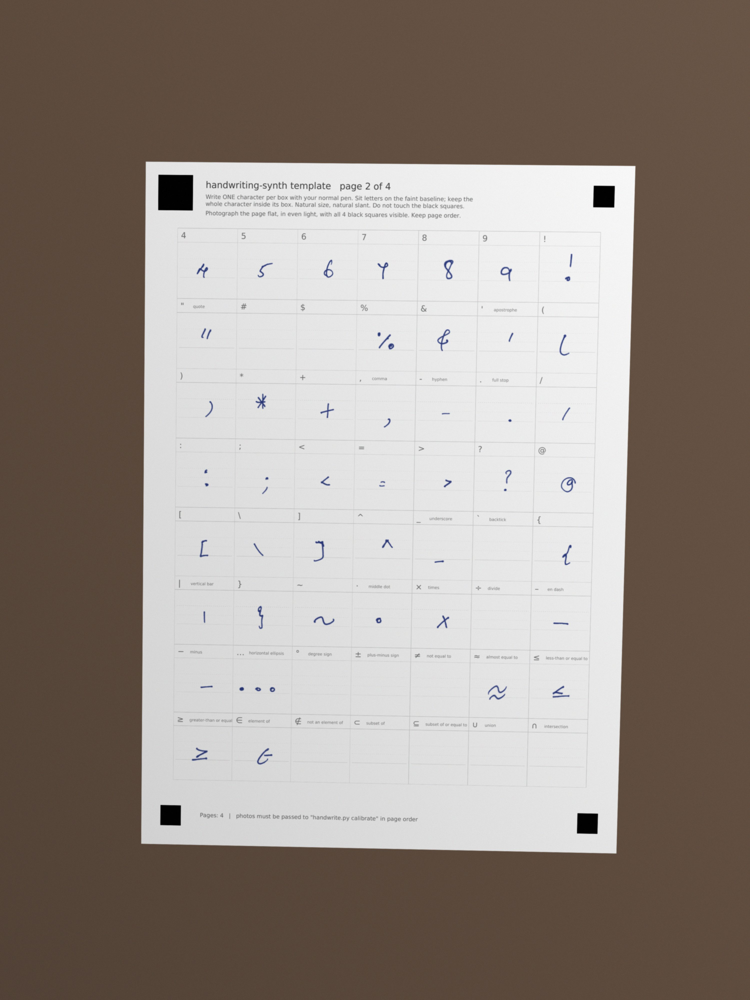
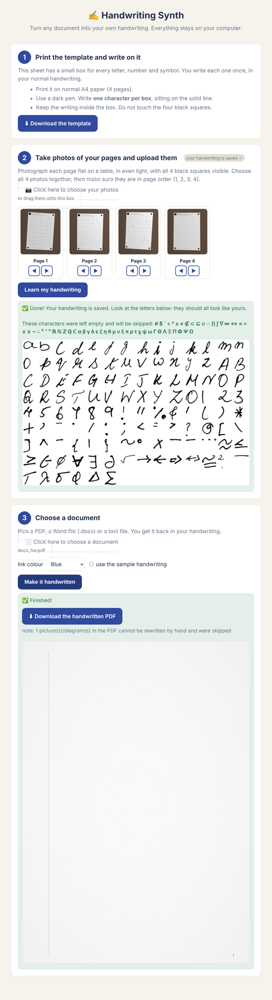
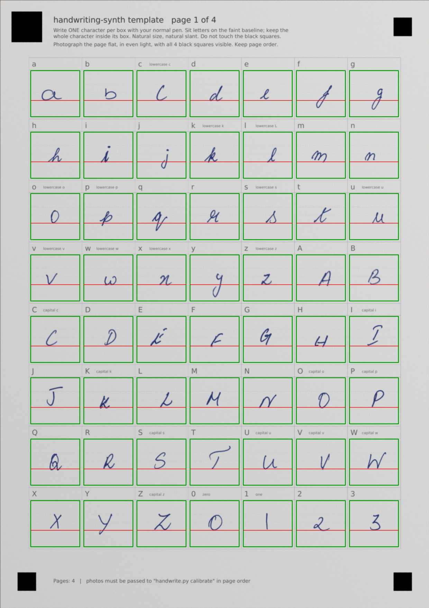

# handwriting-synth

Turn **any PDF, Word, Markdown or text file** into pages written in **your own handwriting**, from a single printed template that you fill in once.

```
 print template ─► write 1 char per box ─► photograph pages ─► calibrate ─► your glyph library
                                                                                   │
        PDF / DOCX / MD / TXT ──► convert ──► handwritten PDF  ◄───────────────────┘
```

> **No neural network is used.** Your handwriting is cut out of the photos once, character by character, and re-assembled with small random variations. It is classical image processing (OpenCV, NumPy, Pillow), so it is deterministic, needs no GPU and no training data, and runs in seconds.



## Just want to use it? Download the app (no coding)

1. Open the **[Releases](../../releases)** page of this repository and download the file for your computer:
   **HandwritingSynth-windows.zip**, **HandwritingSynth-macos.zip** or **HandwritingSynth-linux.zip**.
2. Unzip it, then double-click **HandwritingSynth** (`HandwritingSynth.exe` on Windows).
   * **Windows** may say *"Windows protected your PC"*: click **More info → Run anyway**. (The app is not code-signed.)
   * **Mac**: open the unzipped folder, right-click **HandwritingSynth** → **Open** → **Open**, the first time only (a Terminal window opens; keep it open).
3. Your web browser opens a page with three big steps:
   1. **Download the template**, print it, and write one character in each box.
   2. **Upload photos** of the 4 pages. Click **Learn my handwriting** and check the letters shown.
   3. **Choose a document** (PDF, Word, .md, .txt), pick an ink colour, click **Make it handwritten**, then **Download**.

Everything runs on your own computer; nothing is uploaded to the internet. Your handwriting is saved in a folder called `HandwritingSynth` in your home folder, so you only do step 1 and 2 once. Keep the black window open while you use the app; close it to quit.



Maintainers: the downloads are built by GitHub automatically, and every run first tests the whole pipeline on real **Windows, macOS and Linux** machines (`tests/e2e.py`, in folders with spaces and accents) and then starts the finished app and drives it like a user (`tests/smoke_app.py`). A build is only published if all of that passes. Push a tag (`git tag v1.0.0 && git push --tags`) or run **Actions → Build downloadable apps** by hand. To build locally for your own OS: `pip install -r requirements.txt pyinstaller && python packaging/build.py`.
To run the app from source without packaging: `python src/app.py`.

---

## Getting started in 2 minutes

**1. Download and install** (Python 3.10+ needed)
```bash
git clone https://github.com/Akshath-PG/handwriting-synth.git     # or: Code -> Download ZIP, then unzip
cd handwriting-synth
pip install -r requirements.txt
```

**2. Try it right now with the bundled sample handwriting**
```bash
cd src
python3 handwrite.py convert ../examples/demo.md -o out.pdf
```
Open `out.pdf`: that is a handwritten page.

**3. Use YOUR handwriting (one-time, about 15 minutes)**
1. Print `assets/handwriting_template.pdf` (4 pages, already in the repo).
2. Fill every box with a dark pen: one character per box, letters sitting on the solid baseline, nothing touching the black corner squares.
3. Photograph each page flat, in even light, with all 4 black squares visible. Name the photos so they sort in page order (`p1.jpg` ... `p4.jpg`).
4. Build your library and check it:
   ```bash
   python3 handwrite.py calibrate p1.jpg p2.jpg p3.jpg p4.jpg -o ../work/lib.pkl --debug ../work/debug
   ```
   Open `work/debug/glyph_sheet.png`. If a character is missing or wrong, rewrite that box, re-photograph the page and run the command again.

**4. Convert anything**
```bash
python3 handwrite.py convert notes.pdf                       # also .docx .md .txt
python3 handwrite.py convert report.docx -o report_hw.pdf --ink black
```
With no `--lib`, your `work/lib.pkl` is used if it exists, otherwise the bundled sample. The output goes next to the input file unless you pass `-o`.

**Good to know**
* Pictures and diagrams in a PDF are skipped; ruled tables work best. Look through the result before printing.
* Characters missing from your library are skipped and listed at the end of the run. To add more, edit `src/charset.py` and regenerate the template.
* If the photos come out wrong (very dark or shadowed pages), retake them in better light or try `--threshold 0.78` on `calibrate`.
* Self-test with no handwriting at all: `./tests/run_e2e.sh`.

---

## 1. Quick start (4 commands)

```bash
pip install -r requirements.txt
cd src

python3 handwrite.py template -o ../assets/handwriting_template.pdf     # 1. print this (4 pages, A4)
#   fill every box with your pen, photograph each page flat (see tips below)
python3 handwrite.py calibrate p1.jpg p2.jpg p3.jpg p4.jpg -o ../work/lib.pkl --debug ../work/debug   # 2.
python3 handwrite.py convert  my_notes.pdf -o my_notes_handwritten.pdf  # 3. also .docx .md .txt
python3 handwrite.py convert  report.docx --ink black                   #    --ink blue|black|#RRGGBB
```

No handwriting yet? `convert` falls back to the bundled `examples/sample_library.pkl`, so you can try everything immediately.

Self-test without any handwriting (fake phone photos → calibrate → convert md/docx/pdf):
`./tests/run_e2e.sh`

## 2. The template (`assets/handwriting_template.pdf`)

Generated by `src/make_template.py` (`handwrite.py template`). 4 A4 pages, **174 characters**, one per box:

| group | characters |
|---|---|
| lowercase / UPPERCASE | a–z, A–Z |
| digits | 0–9 |
| ASCII punctuation & code symbols | `! " # $ % & ' ( ) * + , - . / : ; < = > ? @ [ \ ] ^ _ ` { | } ~` |
| typography | `· × ÷ – − … ° ± ≠` |
| maths & logic | `≈ ≤ ≥ ∈ ∉ ⊂ ⊆ ∪ ∩ ∅ ∀ ∃ ∏ ∫ ∂ ∇ √ ∞ → ← ↔ ⇒ ⇔ ∝ ≅ ≡ ∧ ∨ ¬ ∴` |
| super-scripts, number sets | `² ³ ⁺ ⁻ ⁿ ᵀ`, `ℝ ℕ ℤ ℚ ℂ` |
| Greek | `α β γ δ ε ζ η θ λ μ ν ξ π ρ σ τ φ χ ψ ω`, `Γ Δ Θ Λ Ξ Π Σ Φ Ψ Ω` |

Everything else is built from these (fractions, sums, roots, matrices, hats/tildes are *drawn* by the renderer, see §5). To add characters, append them to `src/charset.py`; the template and calibration both read that list.

Each box has: the printed character, a name for ambiguous ones (`lowercase L`, `capital i`, `zero`, `capital o`…), a faint **baseline** and two dotted guide lines. **Four black squares** in the corners (the top-left one is bigger) let the software straighten any photo. Geometry is in `src/layout.py`.

**Filling it in:** one character per box, natural size and slant, letters sitting on the solid baseline, whole character inside the box, nothing touching the black squares. Use a dark pen (pencil works if it is dark).

**Photographing:** one photo per page, **in page order**, flat on a table, even light (no hard shadow of your phone), all 4 black squares visible. The page may be rotated, tilted or on a desk; it is straightened automatically.

## 3. Calibration: photos → glyph library (`src/calibrate.py`)

1. **Find the markers.** Divide the grey photo by a heavily dilated copy (local paper brightness) → dark blobs; keep roughly square, solid ones; the largest is top-left; order the other three clockwise. Works for any rotation.
2. **Straighten.** `cv2.getPerspectiveTransform` from the 4 marker centres to their known positions, warped to 2480×3508 px (A4 @ 300 dpi). Every page now has identical geometry.
3. **Ink mask.** `ratio = pixel / local paper brightness`; ink is `ratio < 0.72`. Independent of shadows and exposure; the faint printed guides (≈0.88) are ignored.
4. **Cut each box** (positions from `layout.py`), drop specks < 25 px, keep a soft alpha mask `clip((0.86 − ratio)/0.42, 0, 1)` so pen-pressure variation and anti-aliasing survive.
5. **Record the baseline offset** (`below`): how far the ink hangs below the printed baseline. This is how descenders (`g y p q j ρ ∫`) and floating symbols (`- + = ·`) get the right height when typesetting.
6. **Checks.** Fails with a clear message if a corner square is missing, the photo count ≠ page count, or essential letters/digits are empty. Warns about characters touching their box edge; lists empty boxes (those characters are skipped when writing). `--debug DIR` saves the straightened pages with the boxes drawn (`rectified_N.jpg`) and a contact sheet of all glyphs (`glyph_sheet.png`).

Output: `lib.pkl = {'lib': {char: {alpha, h, w, pad, below}}, 'cap': capital height in px}`.



## 4. Conversion (`src/loaders.py`, `src/blocks.py`)

| input | what is recognised |
|---|---|
| `.pdf` | headings (by font size/bold), paragraphs (by line gaps), indented items as bullets, `1.` numbered items, ruled tables, monospace text as code, running headers/footers removed, hyphenated line breaks re-joined, LaTeX-looking code converted to handwritten maths |
| `.docx` | Title/Heading 1-3, List Bullet/Number, tables, monospace runs/“Code” style as code |
| `.md` / `.txt` | `#` headings, `-`/`*` bullets, `1.` lists, `\|tables\|`, fenced code, `$$ formula $$` and the maths markup of §5 |

The document is laid out by `doclib.Doc` (margin line, page numbers, wobbly ruled tables, indented code, page breaks) and every character is drawn from your library. Characters your library does not have are listed at the end ("skipped N characters …").

## 5. How the handwriting is drawn (`src/hw_render.py`, `src/doclib.py`)

* **Page**: A4 300 dpi float canvas with paper grain and vignette; ink is alpha-blended in a chosen colour (`--ink`). Tables, arrows and underlines use wobbly hand-drawn lines.
* **Pen**: for every character it applies random rotation (σ≈1.4°), shear, ±2.5 % scale and baseline wobble so repeated letters never look stamped. Letter gap 0.045·cap, word space 0.66·cap.
* **Vertical placement**: from the measured `below` value (libraries made by `calibrate`); older libraries fall back to hand-tuned class tables.
* **Maths markup** (used in `.md/.txt` and generated from LaTeX in PDFs):

| markup | result |
|---|---|
| `x^{2}` `x_{i}` | superscript / subscript |
| `\h{D}` `\t{d}` | hat, tilde |
| `\f{a}{b}` | fraction |
| `\S{i=1}{N}` | sum with limits |
| `\r{...}` | square root |
| `\M{a,b;c,d}` | matrix |

## 6. Repository layout

```
src/app.py, app_page.html  the point-and-click app (local web page)
src/handwrite.py     command line: template | calibrate | convert
packaging/build.py   builds the double-click app (PyInstaller); .github/workflows builds Win/Mac/Linux
src/charset.py       the 174 characters             src/layout.py       template geometry
src/make_template.py generates the PDF template     src/calibrate.py    photos -> library
src/loaders.py       pdf / docx / md readers        src/blocks.py       blocks -> handwritten pages
src/hw_render.py     Page, Pen, markup renderer     src/doclib.py       page/table/code layout
src/normalize.py     text clean-up
src/legacy/          the first prototype pipeline (hand-tuned for one set of photos)
examples/            sample library, source PDF, outputs, build_doc.py (hand-authored 17-page example)
tests/               run_e2e.sh, simulate_photos.py (fake phone photos), sample.docx/.md
```

## 7. Honest limits

* **The app was tested as a packaged program on Linux only**; the Windows and macOS builds are produced by the GitHub workflow and have not been run by the author. Please report problems.
* **Tested with simulated photos** (rotation, perspective, uneven light, blur, noise, JPEG) made from a real handwriting library: all 118 characters drawn were recovered. Please report issues with real photos (different pens, paper, lighting).
* **One sample per character**: repeated letters differ only by random jitter. Not cursive (letters are not joined).
* **PDF conversion is heuristic.** Pictures/diagrams are skipped (reported). Tables are only recognised when ruled; some text boxes may come out as bullets. Bullet symbols drawn as vector shapes are not detected (indentation is used instead). Formulas in a PDF are only reproduced when they appear as LaTeX source; typeset maths is read as plain text.
* Unsupported characters (accents, emoji, CJK …) are skipped and reported; accents are dropped to the base letter.
* The template font labels need DejaVu Sans (or Arial Unicode) for Greek/maths labels; otherwise Unicode codes are printed.
* Keep your photos private if you publish the repo; `samples/` and `work/lib.pkl` are your handwriting.

## 8. License
MIT (add a `LICENSE`).
