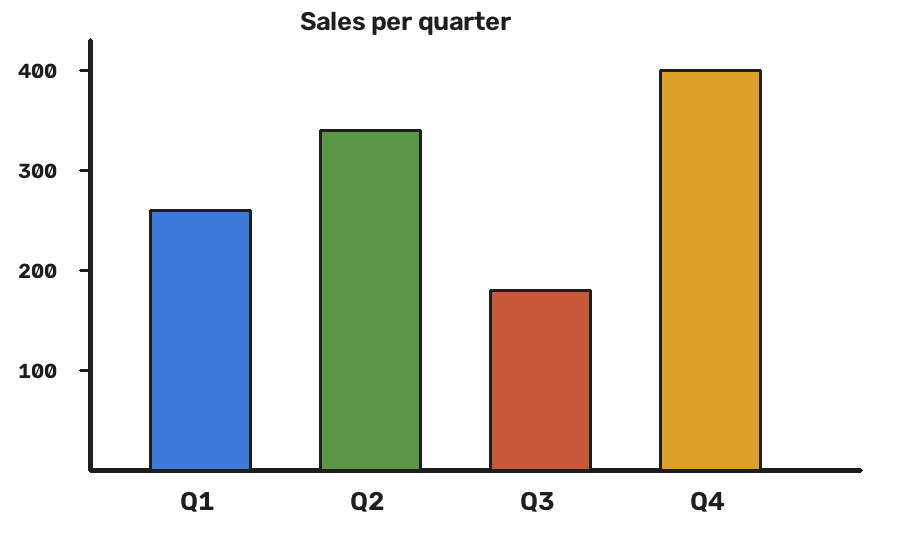

# Quarterly notes

The team wrote these notes by hand during the review. Sales grew in every quarter except the third, and the
fourth quarter was the best of the year. The chart below shows the numbers for each quarter.

- The third quarter was slow because of the holidays.
- The fourth quarter was the strongest, with the new product in the shops.

Next year the team wants to repeat the fourth quarter and to start the new product earlier in the year.
